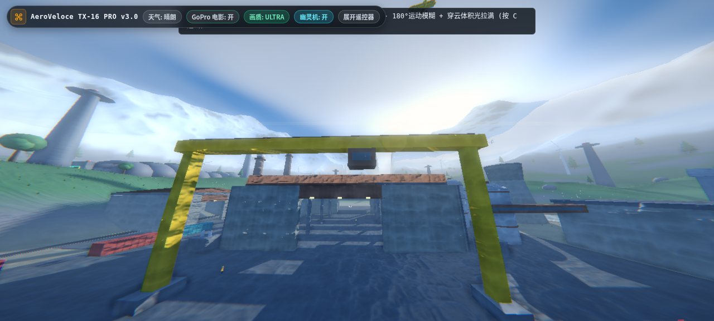
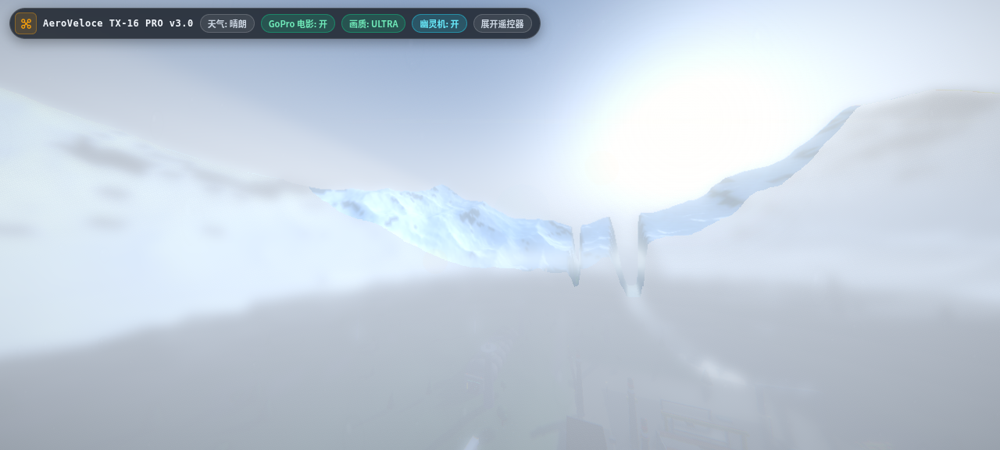
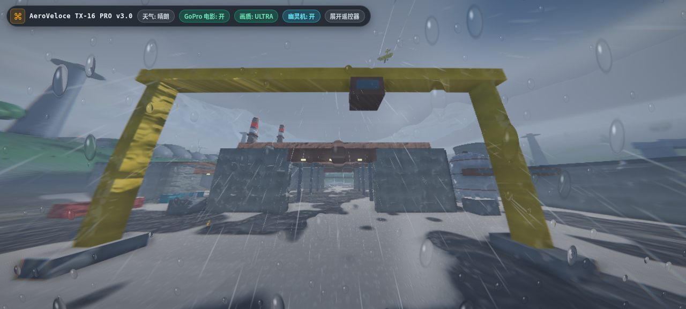
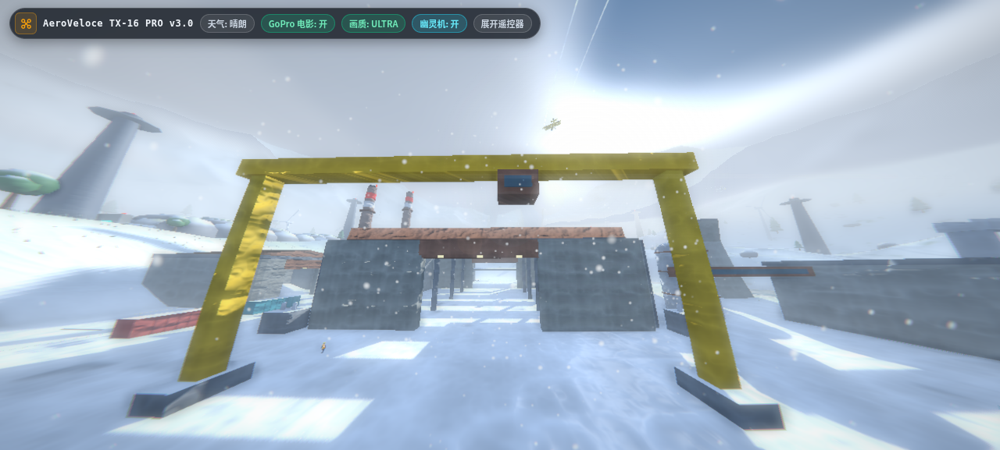

# AeroVeloce FPV PRO v3.0 — Zero-Dependency Cinema-Grade WebGL FPV Drone Simulator & 3D GCS

[](https://s3805.github.io/fpv-flight-simulator/)
[-10b981?style=for-the-badge)](#architecture)
[](#flight-physics)

**9,500+ lines of pure vanilla JavaScript and 11 custom GLSL shaders. Zero external 3D models, zero external audio files, zero frameworks or CDN dependencies.**

一款纯手写零依赖的电影级 3D WebGL 穿越机飞行模拟器与三维航线规划地面站（GCS），内建 480Hz 刚体飞控、真·光线步进 3D 穿云体积云、动态雨雪 Wet PBR 与 GoPro 镜头水滴折射、双级联 CSM 软阴影 + 深度双边 SSAO，以及全程序化合成的无刷电机/洗桨/多普勒音效引擎。

---

## Live Preview & Standalone Download

- **Play Online (60fps Native GPU)**: https://s3805.github.io/fpv-flight-simulator/
- **Offline Single-File Bundle**: Download [`dist/fpv_drone_simulator.html`](dist/fpv_drone_simulator.html) (~410 KB) and double-click to fly completely offline in any modern browser.

---

## v3.0 Visual Highlights

| Clear Alpine (2-Cascade CSM + Depth SSAO) | 212m Fly-Through 3D Volumetric Cloud Sea |
| :---: | :---: |
|  |  |
| **Rainstorm Wet PBR Puddles + Crystal GoPro Raindrops** | **Alpine Blizzard Dynamic Snow Accumulation** |
|  |  |

---

## Key Features

### Cinema-Grade WebGL Graphics (`renderer.js`, 11 Custom GLSL Shaders)
- **True Raymarched 3D Volumetric Clouds (165m – 295m)**: 3D FBM cloud density field with Beer-Lambert transmittance, 2-tap sunward self-shadowing, Henyey-Greenstein silver lining, IGN dithering, and **depth-occluded fly-through clouds** so alpine peaks realistically pierce the cloud sea.
- **2-Cascade Real-Time Soft Shadows (CSM)**: Near razor-sharp `2048²` cascade (96m radius) seamlessly blended into a `1024²` macro cascade (520m radius) with texel-snapping and zero swimming.
- **Depth-Texture Slope-Invariant SSAO + Cross-Bilateral Blur**: Samples 24/32-bit `WEBGL_depth_texture` via 6 symmetric depth-curvature pairs (12 taps) to produce clean corner/ground contact shadows with zero slope artifacts.
- **Chamonix-Grade Triplanar Ridged-FBM Micro-Normals & Color Science**: Fragment-level rock/snow/concrete relief, snow crystal sparkle, and warm-sunlight vs. cool-blue skylight shadow contrast.
- **Dynamic Weather Engine (`Clear` / `Rain` / `Snow`)**:
  - **Wet PBR**: High-contrast dark damp asphalt/concrete + mirrored rainwater puddles with animated concentric raindrop ripples.
  - **Crystal-Clear GoPro Lens Raindrops**: Optical glass refraction beads sliding down the lens (triggered by rain, low-altitude water skimming, or flying through clouds).
  - **GPU Infinite-Wrap 3D Precipitation**: 1,800 zero-CPU-overhead aerodynamic rain streaks (stretched along relative flight velocity) or swirling alpine snowflakes.
  - **Dynamic Snow Accumulation**: Real-time snow accumulation on terrain, roofs, factory slabs, and frosted foliage.
- **GPU Wind & Prop-Wash Reactive Foliage + Water Ripples**: 5,400 grass tufts blow radially outward under low-altitude prop downwash; flying low over rivers/lakes excites expanding concentric wake rings.
- **GoPro Pure Cinema Mode (`C`) & 4 Camera Modes (`V`)**: One-click clean cinema footage (hides HUD, gates, waypoints, and RC overlay) with 180° shutter velocity motion blur, volumetric God Rays, tunnel-exit/cloud-breakout Auto-Exposure, and ACES filmic tone mapping. Includes `FPV`, `CHASE`, `ORBIT`, and `GROUND` telephoto pan-tracking cameras.

### Flight Physics, World & Procedural Audio
- **480Hz Sub-Stepped Rigid-Body Physics (`physics.js`)**: Authentic `ANGLE` / `HORIZON` / `ACRO` modes with Betaflight SuperExpo rates, `AirMode`, ground-effect cushion, 357 AABB obstacle colliders, freestyle trick combo scoring, and holographic Ghost Drone PB racing.
- **Rich Open World (`world.js`, `assets_model.js`, `drone_model.js`)**: Alpine snow peaks, winding river & lake, abandoned steel factory ("Bando") with fly-through skylights, valley town, canyon bridges, wind turbines, west mountain FPV tunnel, moving ground traffic, pedestrians, and 5 patrolling radial-engine biplanes.
- **3D Waypoint GCS (`gcs.js`)**: Interactive top-down mission planner with terrain elevation profile, custom 3D waypoints, autonomous mission flight, and one-click RTH.
- **Procedural Web Audio Engine (`audio.js`)**: 4-motor brushless harmonics, prop-wash vortex flutter, 3D Doppler piston biplanes, tactile TX switch clicks, and dynamic rainstorm/blizzard ambience.

---

## Controls & Shortcuts

| Key / Control | Action |
| :--- | :--- |
| `Space` | Arm / Disarm Motors (解锁 / 上锁) |
| `W / S` & `A / D` | Throttle & Yaw (左摇杆：油门 / 偏航) |
| `Arrow Keys` or `I / K / J / L` | Pitch & Roll (右摇杆：俯仰 / 横滚) |
| `E` | Cycle Weather: **Clear → Rainstorm → Alpine Blizzard** |
| `C` | Toggle **GoPro Pure Cinema Mode** (clean real-footage view) |
| `V` | Cycle Camera: **FPV → CHASE → ORBIT → GROUND Telephoto** |
| `M` | Cycle Flight Mode: **ANGLE → HORIZON → ACRO** |
| `H` | Toggle Holographic Ghost Drone |
| `G` | Toggle 3D Waypoint GCS Planner |
| `R` / `T` | Reset to Helipad / Level Attitude Recovery |

Supports on-screen dual virtual gimbals, keyboard, and Web Gamepad API (USB FPV radio controllers such as RadioMaster TX16S / Boxer).

---

## Architecture

```text
├── index.html           # App shell, TX-16 hardware RC UI, GCS panel & tuning drawer
├── index.css            # Tactical dark UI styling
├── world.js             # Procedural terrain heightfield, river, factory & landmark generators
├── assets_model.js      # Procedural 3D meshes (factory, town, bridges, biplanes, vehicles)
├── drone_model.js       # Procedural 5" carbon-fiber FPV quadcopter & spinning prop discs
├── physics.js           # 480Hz rigid-body flight dynamics, AirMode, AABB collisions & Ghost PB
├── renderer.js          # WebGL engine with 11 custom GLSL shaders (CSM, SSAO, 3D Clouds, Wet PBR)
├── audio.js             # Procedural Web Audio synthesizer (motors, prop-wash, Doppler, weather)
├── gcs.js               # Interactive 2D/3D waypoint mission planner & elevation profile
├── app.js               # Main loop, input/gamepad handling & UI bindings
├── dist/
│   └── fpv_drone_simulator.html  # Self-contained offline single-file build
└── docs/                # Real WebGL capture previews
```

## Local Run

Simply open [`dist/fpv_drone_simulator.html`](dist/fpv_drone_simulator.html) directly in Chrome/Edge/Safari/Firefox, or serve the root directory with any static server:

```bash
python3 -m http.server 8080
```
